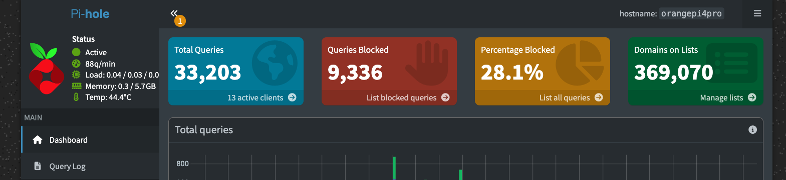

# 🌡️ Pi-hole Sidebar Mods

Welcome! 👋 This is a small set of scripts that adds a couple of handy stats to your Pi-hole v6 admin sidebar:

| Out of the box | With these mods |
|---|---|
| `Memory usage: 5.6 %` | `Memory: 0.3 / 5.7GB` |
| *(no temperature)* | `Temp: 44.4°C` |

<p align="center">
  
</p>

Pi-hole v5 used to show CPU temperature in the sidebar, and v6 dropped it. If you run Pi-hole on a little single-board computer, you probably like keeping an eye on how warm it's running. This repo brings that back and makes memory usage easier to read at a glance.

I built this for my **Orange Pi 4 Pro**, but it works on most boards with a few small tweaks. Read on and I'll walk you through it.

---

## ✨ What you get

- **CPU temperature** in the sidebar, styled just like the other stats
- **Memory in GB** (used / total) instead of a percentage
- **Auto re-apply after updates**, so `pihole -up` won't wipe your changes
- **Easy undo** with one command if you change your mind

---

## 📋 Before you start

You'll need:

- **Pi-hole v6** installed directly on your device (not in Docker; see the [Docker section](#-running-pi-hole-in-docker) if that's you)
- **Root access** (`sudo`)
- About **5 minutes**

A few terms that'll come up:

- **Thermal zone**: a file where Linux reports a sensor's temperature, at `/sys/class/thermal/thermal_zoneN/temp`. Values are in millidegrees, so `44000` means 44.0°C.
- **`sidebar.lp`**: the Pi-hole file that builds the sidebar. The temperature line goes here.
- **`footer.js`**: the Pi-hole file that refreshes CPU and memory stats every few seconds. The memory change goes here.

---

## 🔍 Step 1: Find your CPU temperature sensor

Every board names its sensors a little differently, so let's check yours first. Run this on your Pi-hole device:

```bash
for z in /sys/class/thermal/thermal_zone*; do echo "$z  $(cat $z/type)  $(cat $z/temp)"; done
```

Here's what it looks like on an Orange Pi 4 Pro:

```
/sys/class/thermal/thermal_zone0  cpub_thermal_zone  43896
/sys/class/thermal/thermal_zone1  ddr_thermal_zone   44392
/sys/class/thermal/thermal_zone2  npu_thermal_zone   44206
/sys/class/thermal/thermal_zone3  cpul_thermal_zone  45508
/sys/class/thermal/thermal_zone4  gpu_thermal_zone   43896
```

Look for the zones with **cpu** in the name. Note their numbers.

> 💡 **Why two CPU zones?** Some chips (like the Allwinner A733) have two CPU clusters: fast "big" cores and efficient "little" cores. Each gets its own sensor. The script shows whichever one is hotter.

---

## 📥 Step 2: Download the scripts

```bash
git clone https://github.com/ninjaSnaz/pihole-sidebar-mods.git
cd pihole-sidebar-mods
```

---

## ✏️ Step 3: Match the script to your board

Open `temp.snippet` and find this line:

```lua
local a, b = rd(0), rd(3)
```

Change the numbers to your CPU zones from Step 1:

| Your board has... | Use |
|---|---|
| Two CPU zones (e.g. 0 and 3) | `rd(0), rd(3)` |
| One CPU zone (e.g. Raspberry Pi) | `rd(0), rd(0)` |
| CPU zone is a different number | Swap in your number, like `rd(2), rd(2)` |

Using an Orange Pi 4 Pro? You can skip this step. It's already set up for you.

---

## 🚀 Step 4: Install

```bash
sudo bash install.sh
```

That's it! The installer:

1. Adds the temperature line to the sidebar
2. Switches memory to show GB
3. Backs up the original files (as `.bak`) first
4. Sets up a cron job to re-apply everything every 4 hours

Now **hard-refresh** your Pi-hole admin page to see the changes:

- **Mac:** Cmd + Shift + R
- **Windows / Linux:** Ctrl + Shift + R

You should see your new stats in the sidebar. 🎉

---

## 🔄 What happens when Pi-hole updates?

Pi-hole updates replace the files these scripts edit, so your changes would disappear. That's what the cron job is for. Every 4 hours it checks whether the mods are still in place and quietly puts them back if they're not. When nothing's changed, it does nothing.

Want them back right away after an update? Run:

```bash
sudo ./apply.sh
```

---

## ↩️ Changing your mind

No hard feelings! To undo everything:

```bash
sudo bash uninstall.sh
```

This puts back your original Pi-hole files and removes the cron job.

---

## 📁 What's in the box

| File | What it does |
|---|---|
| `install.sh` | Applies the mods and sets up the cron job. Start here |
| `apply.sh` | Makes the actual edits. Safe to run as often as you like |
| `temp.snippet` | The bit of code that reads your temperature sensor |
| `uninstall.sh` | Restores the originals and removes the cron job |

---

## 🛠️ How it works (for the curious)

### Temperature

The installer finds the memory line in `sidebar.lp` and adds the contents of `temp.snippet` right below it. The snippet reads your CPU sensors each time the page loads and prints the temperature.

> Note: temperature updates when you load or refresh the page. It doesn't tick live like CPU and memory do.

### Memory

The installer tweaks three lines in `footer.js`:

```js
// Before
'"></i>&nbsp;&nbsp;Memory usage:&nbsp;' +
percentRAM.toFixed(1) +
"&thinsp;%"

// After
'"></i>&nbsp;&nbsp;Memory:&nbsp;' +
(system.memory.ram.used / 1048576).toFixed(1) + " / " + totalRAM.toFixed(1) +
"&thinsp;" + totalRAMUnit
```

Pi-hole reports memory in KB, so dividing by 1,048,576 turns it into GB. The memory line still turns red above 75% used, and hovering over it still shows swap usage.

> 💡 **Why does my 6 GB board show 5.7 GB?** Your board's firmware and kernel reserve a slice of RAM at boot. That's completely normal.

---

<br>

## ✋ Prefer to do it by hand?

You totally can! This walks through the exact same changes the scripts make, one step at a time. Each step tells you what to type and what to expect.

> All commands below run **on your Pi-hole device** (over SSH or directly on it), as **root**. If you're not root, put `sudo` in front of each command.

### Part 1: Find your CPU temperature sensor

**1. List your sensors**

```bash
for z in /sys/class/thermal/thermal_zone*; do echo "$z  $(cat $z/type)  $(cat $z/temp)"; done
```

**2. Note the numbers of the zones with `cpu` in the name.** For example, `thermal_zone0` and `thermal_zone3` mean your numbers are **0** and **3**. You'll need them in Part 3.

### Part 2: Back up the files you'll edit

If anything goes wrong, these backups let you undo everything.

**1. Back up the sidebar file**

```bash
cp /var/www/html/admin/scripts/lua/sidebar.lp /var/www/html/admin/scripts/lua/sidebar.lp.bak
```

**2. Back up the memory file**

```bash
cp /var/www/html/admin/scripts/js/footer.js /var/www/html/admin/scripts/js/footer.js.bak
```

Neither command prints anything. That means it worked.

### Part 3: Add the temperature line

**1. Find the memory line in the sidebar file**

```bash
grep -n 'id="memory"' /var/www/html/admin/scripts/lua/sidebar.lp
```

You'll see something like this. The number at the start is the **line number**:

```
23:                    <span id="memory"></span>
```

**2. Open the file at that line** (swap `23` for your line number)

```bash
nano -l +23 /var/www/html/admin/scripts/lua/sidebar.lp
```

This opens the **nano** text editor with your cursor on the memory line. `-l` shows line numbers down the left side.

**3. Jump to the end of the line**

Press **End**. On a Mac keyboard without an End key, press **Ctrl + E**.

**4. Add a line break tag**

Type `<br>` so the line reads:

```html
<span id="memory"></span><br>
```

**5. Start a new line**

Press **Enter**.

**6. Paste the temperature code**

Copy everything below and paste it in. In most terminals, paste is **right-click**, **Ctrl + Shift + V** (Windows / Linux), or **Cmd + V** (Mac).

```html
<span id="temperature"><i class="fa fa-fw fa-temperature-three-quarters text-green-light"></i>&nbsp;&nbsp;Temp: <?
local function rd(z)
  local f = io.open("/sys/class/thermal/thermal_zone" .. z .. "/temp")
  if not f then return nil end
  local t = tonumber(f:read("*a")); f:close(); return t
end
local a, b = rd(0), rd(3)
local t = (a and b) and math.max(a, b) or a or b
mg.write(t and string.format("%.1f&deg;C", t / 1000) or "N/A")
?></span><br>
```

**7. Match the sensor numbers to your board**

Find the line `local a, b = rd(0), rd(3)` and change `0` and `3` to your numbers from Part 1. Only one CPU zone? Use the same number twice, like `rd(0), rd(0)`.

**8. Save and exit**

- Press **Ctrl + O**, then **Enter** to save
- Press **Ctrl + X** to exit

**9. Check your work**

Hard-refresh the Pi-hole admin page: **Cmd + Shift + R** (Mac) or **Ctrl + Shift + R** (Windows / Linux). You should see `Temp: xx.x°C` under Memory usage.

### Part 4: Show memory in GB

**1. Find the memory code**

```bash
grep -n 'Memory usage' /var/www/html/admin/scripts/js/footer.js
```

You'll see something like:

```
318:          '"></i>&nbsp;&nbsp;Memory usage:&nbsp;' +
```

**2. Open the file at that line** (swap `318` for your line number)

```bash
nano -l +318 /var/www/html/admin/scripts/js/footer.js
```

**3. Find these three lines.** Your cursor sits on the first one:

```js
          '"></i>&nbsp;&nbsp;Memory usage:&nbsp;' +
          percentRAM.toFixed(1) +
          "&thinsp;%"
```

**4. Delete those three lines**

With the cursor on the first line, press **Ctrl + K** three times. Each press removes one line.

**5. Paste the replacement**

Copy these three lines and paste them where the old ones were:

```js
          '"></i>&nbsp;&nbsp;Memory:&nbsp;' +
          (system.memory.ram.used / 1048576).toFixed(1) + " / " + totalRAM.toFixed(1) +
          "&thinsp;" + totalRAMUnit
```

**6. Save and exit**

- Press **Ctrl + O**, then **Enter** to save
- Press **Ctrl + X** to exit

**7. Check your work**

Hard-refresh the admin page again. Memory should now read something like `Memory: 0.3 / 5.7GB`. Still showing `%`? Your browser cached the old file, so try a private window.

### Part 5: Undo (if you need to)

Something look off? Put the originals back:

```bash
cp /var/www/html/admin/scripts/lua/sidebar.lp.bak /var/www/html/admin/scripts/lua/sidebar.lp
cp /var/www/html/admin/scripts/js/footer.js.bak /var/www/html/admin/scripts/js/footer.js
```

Then hard-refresh the admin page.

> ⚠️ **Heads up:** Pi-hole updates (`pihole -up`) overwrite these files, so hand edits disappear after an update. To keep them automatically, use the [install script](#-step-4-install) instead.

<br>

---

## 🐳 Running Pi-hole in Docker?

These scripts expect Pi-hole installed directly on the device. In Docker, the files live inside the container, so you'd copy them out, edit them, and copy them back:

```bash
docker cp pihole:/var/www/html/admin/scripts/lua/sidebar.lp ./sidebar.lp
docker cp pihole:/var/www/html/admin/scripts/js/footer.js ./footer.js
# make your edits, then docker cp them back in
```

Heads up: those changes vanish when the container is recreated, unless you bind-mount your edited files.

---

## 🧰 Troubleshooting

| What you see | Likely cause | Try this |
|---|---|---|
| Nothing changed | Your browser cached the old files | Hard-refresh or open a private window |
| `Temp: N/A` | The zone numbers don't match your board | Redo Step 1 and update `temp.snippet` |
| `SKIPPED, layout changed` | A Pi-hole update restructured the files | Open an issue and let me know! |
| Sidebar looks broken | Something went wrong in the edit | Run `sudo bash uninstall.sh` |
| Memory still shows `%` | The `footer.js` edit didn't match | Run `grep -n 'Memory' /var/www/html/admin/scripts/js/footer.js` and compare with the "How it works" section |

---

## 🤝 Contributing

Got it working on a different board? Found a bug after a Pi-hole update? Issues and pull requests are always welcome. Sharing your board's thermal zone layout helps the next person too.

---

## 🙏 Thanks

Big thanks to the [Pi-hole](https://pi-hole.net) team for an awesome project, and to the folks on the [Pi-hole Discourse](https://discourse.pi-hole.net) who shared their own sidebar tweaks and inspired this one.

Happy blocking! 🛡️
